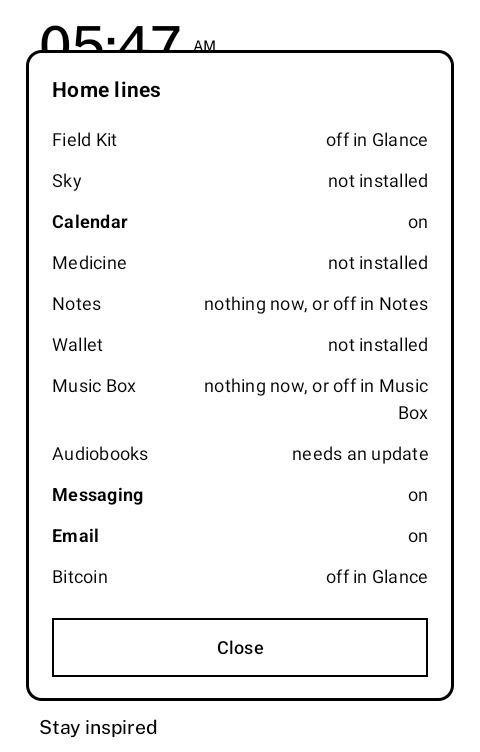
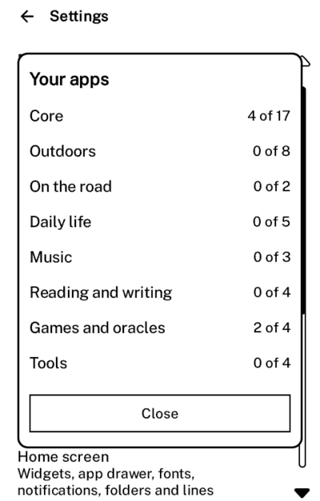

# 庵 iori — Home

Home is a plain, quiet home screen for E Ink phones. It is a fork of
[inkOS](https://github.com/gezimos/inkos), the text launcher by
[gezimos](https://github.com/gezimos), with a few things added for the
[Mudita Kompakt](https://mudita.com/products/mudita-kompakt) and for a family of apps made to
work together.

*Iori* (庵) is a small hut: one room, a roof, little in it. That is what a home screen with a
handful of words on it is meant to be.

Everything inkOS does still works here. inkOS's [documentation](DOCUMENTATION.md) applies as
written, and inkOS's own README is kept in [docs/README-inkOS.md](docs/README-inkOS.md). For
plain inkOS, go to [gezimos's repository](https://github.com/gezimos/inkos) or
[IzzyOnDroid](https://apt.izzysoft.de/fdroid/index/apk/app.inkos).

| | |
|---|---|
|  |  |
|  |  |

## Which phones

- **Mudita Kompakt**, on Mudita's own system (MuditaOS K) and on
  [KompaktOS](https://github.com/gezimos/KompaktOS). This is the phone it is made on and
  tried on.
- **Other Android phones from Android 10 on.** Home installs on Android 8 and 9 too, but it is
  not tried there.

Home is its own app (`com.wanderwildwood.iori`), so it installs beside inkOS rather than
replacing it, and either one can be the home app.

## What it does that inkOS does not

- **A first run of its own.** Six pages: welcome and privacy; setup (make Home the home app,
  notification access); your apps; default apps; Nextcloud; theme and home apps.
  **Settings → Run setup again** opens it again. Nothing is reset.
- **One Nextcloud account** for the whole phone. See below.
- **Your apps**: the apps made to work with Home, in folders, installed or missing, with
  Install and Update. See below.
- **Default apps.** One row for each kind of thing an app of the family opens: calls, texts,
  contacts, calendar, alarms, gallery, maps, text files, passwords and more. Each row says what
  Android does today. Press a row that is not chosen, pick the app, then Always.
- **Lines on home.** Up to three lines under the home apps: today's events, the weather, what
  is unread. They come from [Glance](https://github.com/wanderwildwood/hitome) 0.1.24 or later
  and follow the choices made there. A press opens the app the line came from. A long press
  lists each source and what it is doing. The lines can sit at the bottom or at the top.
- **Music on the lock screen** for any player, above the padlock, on MuditaOS 1.x, where the
  Kompakt's own widget shows only Mudita's player. On MuditaOS 2.0 and KompaktOS the phone's own
  lock screen shows a player for any app, so Home's strip stands aside there.
- **Dark mode for the whole family.** On MuditaOS, Settings → Dark mode turns Home dark, and
  the other apps of the family follow it. On KompaktOS and other phones, Home follows the
  phone's own dark setting.
- **E-ink mode per app** on MuditaOS 2.0 and later: hold an app in the drawer, then E-ink mode.
  It writes the same table as Mudita's own E-ink Modes screen.
- **Folders in the app drawer.** Hold an app, then Folder.
- **Hand-offs.** With no app picked for the clock or the date, a press opens Time or Datebook.
  A contact found in search opens in Connections. If that app is not on the phone, Home offers
  to get it, or to keep using the phone's own.
- **Settings in groups**: Phone, Apps, Home screen, Setup and about, in the same plain look as
  the other apps of the family. inkOS's own pages and rows are all still there.
- **Two small fixes.** All-day events show on their own date. A notification its app marked
  as not to badge, such as a running service, no longer puts a dot on the app.
- **Backups from inkOS** restore into Home, with hidden apps and internal shortcuts still
  working.

In English, Home's words say Home wherever they mean this app, so two launchers on one phone can
be told apart. Credits to inkOS and gezimos stay as they are. Other languages still say inkOS.

## One Nextcloud account

Sign in to your Nextcloud once, in the first run or in **Settings → Nextcloud account**. Home
uses Nextcloud's own login in the browser. On a phone with no browser you can type an app
password, or your login password: a login password is used once to get an app password and is
not kept.

Home keeps one app password, locked with a key in the phone's keystore, in a file left out of
backups. Nextcloud's device list shows it as one entry, so revoking it there signs out every
app at once. Signing out in Home also asks the server to delete it.

The apps of the family that use Nextcloud get a row **Use the phone's Nextcloud account**.
Home hands the account only to those apps, checked by package name and by the certificate
their releases are signed with. Anything else gets nothing. Each app still works without Home,
with its own login.

For developers: the account is at `content://com.wanderwildwood.iori.accounts/nextcloud`. It is
read-only, with one row (`server`, `user`, `password`, `stamp`) while signed in and no row
while signed out, and a change notice goes out on that address when the account changes. The
callers allowed are `CALLERS` in
[`IoriAccount.kt`](app/src/iori/java/com/wanderwildwood/iori/IoriAccount.kt).

## Your apps

**Settings → Your apps** lists the apps made to work with Home in a folder for each group
(Core first). Each folder says how many of its apps are on the phone, or how many can be
updated or are being installed. In a folder, each app says what it is, the version on the
phone or "Not installed", how an install is going, and has Install, Update or Up to date.
The list comes from <https://wanderthe.dev/apps.json>; the copy from last time is shown when
there is no connection. The first run has the same apps as a page of tick boxes, with the core
apps that are missing already ticked, and installs them the same way, one after the other.

Every app Home installs, from Settings, the first run, or the offer to get a missing app,
goes through the same checks. A download is installed only if its size and SHA-256 are the
list's, it is the package and version the list names, it is signed with the list's key and no
other, that key is the one Home itself carries for the app, and, for an update, the app on
the phone is signed with the same key. Android asks once before each first install. On
Android 12 and later, an app Home installed can then be updated without asking again.

## What it sends

Nothing about you. Home has no server of its own. Unlike inkOS, it has the internet
permission, for these things only:

- **Your apps**: when you open it in Settings, it reads the list of the house's apps from
  <https://wanderthe.dev/apps.json>, and it downloads from GitHub the ones you ask for, there,
  on the first run's page (which reaches nothing until you press GET), or from the offer to get
  a missing app. Only release downloads of wanderwildwood's own GitHub repositories are
  followed; a list that names any other address for an app is not. Each download is installed
  only if its size, checksum, package, version and signing key match the list and the key Home
  already holds for that app, and it is not older than the release that was out when this Home
  was built.
- **Nextcloud**: only the server you sign in to, to sign in and to sign out.

These requests name the app only as "Home", not the phone's model or Android build.

Settings, usage counts and everything shown on home stay on the phone. Android's own backup
(to Google) and phone-to-phone transfer take nothing of Home's; to move your layout, use Back
up and restore in Home's settings. A crash report is sent only if you choose to, as an email
from your own mail app, to this app's address and not to gezimos. It holds the error itself,
Home's version, the app it was installed from, and the phone's maker, model, Android version
and processor type: nothing about the apps you use. Home lines come from Glance on the phone,
read only when Glance is signed with its own release key, and do not leave the phone either.

The permissions are inkOS's, plus four: internet, asking Android to install an app, updating
an app Home installed, and setting an alarm (to ask which app opens alarms). Two services stay
off until you turn them on in Android's settings: **Home actions**, an accessibility service
for the gesture actions and the lock-screen music strip, which watches only the lock screen;
and **notification access**, for badges, Letters and the music widget.

## Installing

Download <https://github.com/wanderwildwood/iori/releases/latest/download/iori.apk> and open
it. That address always points at the newest release, with a `.sha256` file beside it. Every
release is signed with the same key, so a later one installs over it and keeps your settings.

For updates, add this repository to [Obtainium](https://github.com/ImranR98/Obtainium):

    https://github.com/wanderwildwood/iori

For lines on home, install [Glance](https://github.com/wanderwildwood/hitome) 0.1.24 or later
too.

### Two launchers on one phone

To Android, Home and inkOS are two separate apps. Accessibility, notification access, widgets,
pinned shortcuts and private space are given to each one on its own and do not carry over.

On Android 13 and later (KompaktOS among them), an app installed from a file may find its
accessibility and notification access switches greyed out. Open App info, tap ⋮, then
**Allow restricted settings**, and try again. Apps that Home installs are not blocked this
way.

## Building

You need JDK 17 or newer and the Android SDK (compile SDK 36). Android Studio works too.

```sh
./gradlew assembleDebug testDebugUnitTest   # debug build and unit tests
./gradlew assembleRelease                   # release build
```

The debug build is `com.wanderwildwood.iori.debug` ("Home Debug"), so it installs beside a
release. A release is signed only when `KEYSTORE_FILE`, `KEYSTORE_PASSWORD`, `KEY_ALIAS` and
`KEY_PASSWORD` are set; without them it comes out unsigned. There is no fallback key, and the
release key is not in this repository. Releases are built locally; the GitHub workflows that
came with inkOS are switched off.

Everything that makes this build Home rather than inkOS is in `app/iori.gradle` and
`app/src/iori/`. An upstream file changes only at lines marked `// iori:`, apart from a few
whole commits (folders, lock-screen music, the two fixes). [IORI.md](IORI.md) lists each one
and how upstream is merged in. The two fixes that are not particular to Home are one commit
each, so they can be offered back to inkOS.

## Licence and credits

Home is free software under the GNU General Public License, version 3 only. See
[LICENSE](LICENSE). Home's additions are copyright © wander wildwood. Everything else is
inkOS's, and inkOS is gezimos's work.

- [inkOS](https://github.com/gezimos/inkos) by gezimos, GPL-3.0. Nearly all of this app is
  inkOS. inkOS was first forked from [mLauncher](https://github.com/DroidWorksStudio/mLauncher),
  itself a fork of [Olauncher](https://github.com/tanujnotes/Olauncher), both GPL-3.0.
- The lock-screen music strip follows [Katapult](https://github.com/gezimos/Katapult) by
  gezimos, GPL-3.0.
- The scrollbar chevrons of Home's own lists are from
  [Mudita Mindful Design](https://github.com/mudita/MMD), Apache-2.0.
- The fonts and pictures that came with inkOS, their licences, and what was left out because it
  came with none (the Hoog font, the picture wallpapers, inkOS's store pictures), are listed in
  [CREDITS.md](CREDITS.md).

In the app, **Settings → About Home → Licenses** lists every library and font with its
licence, and **inkOS's own About**, a row of About Home, keeps gezimos's credits and links. If
inkOS has made your phone better, the coffee cup in About Home opens gezimos's Buy Me a Coffee.
