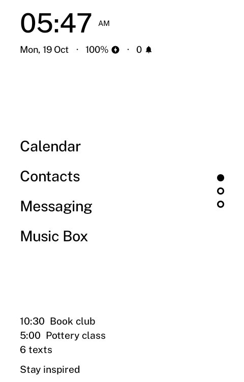
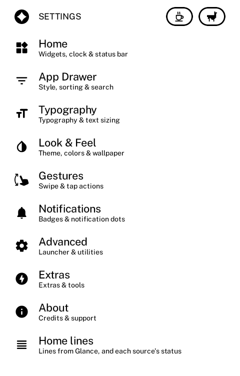
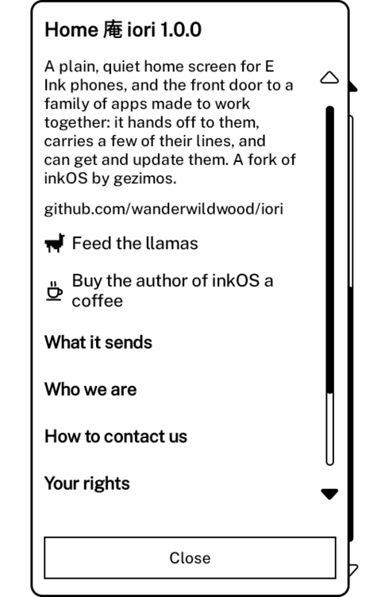

# 庵 iori — Home

inkOS, the text launcher for e-ink phones, with a few additions for the
[Mudita Kompakt](https://mudita.com/products/mudita-kompakt): a few lines under the home apps
from the phone's other apps, music controls on the lock screen for any player, and contacts
that open in Contacts.

*Iori* is 庵 — a hermitage, a small hut: one room, a roof, little in it. It is the kind of place
a home screen with a handful of words on it is meant to be.

Based on [inkOS](https://github.com/gezimos/inkos) by [gezimos](https://github.com/gezimos).
Everything inkOS does still works here, and inkOS's [documentation](DOCUMENTATION.md) applies
as written. Home is its own app (`com.wanderwildwood.iori`), so it installs beside inkOS
rather than replacing it, and either can be the home app. For plain inkOS, go to
[gezimos's repository](https://github.com/gezimos/inkos); it is also on
[IzzyOnDroid](https://apt.izzysoft.de/fdroid/index/apk/app.inkos).

| | |
|---|---|
|  |  |
|  |  |

## Lines on home

Up to three lines under the home apps, in the quote's font, size and alignment: today's events,
the weather, what is unread, and whatever else [Glance](https://github.com/wanderwildwood/hitome)
shows on the lock screen. They come from Glance, so **lines need Glance 0.1.24 or later**, and
they keep to the choices made there: the same apps, in the same order, each following its own
lock-screen switch. An app whose lock-screen line is off has no line on home either. Other
apps' notifications are never part of it.

Pressing a line opens the app it came from. A long press opens **Home lines**, a list of the
sources and what each is doing: on, off here, not installed, needs an update, nothing now or off
in the app, off in Glance, did not answer. Pressing one there turns it on or off on home only,
and leaves the lock screen as it was. When Glance itself is the trouble, the list says so
instead: not installed, needs 0.1.24, does not know this build, or did not answer.

With no lines to press, the same list is under **Settings → Home lines**, and home shows a
"Home lines" row while it is being edited. The list turns its pages on whole rows, with Close
always on screen, at any text size.

Apps are named as the Kompakt's launcher names them ("Medicine", "Wallet"), installed or not.

If this app's own code ever crashes, inkOS's crash report still comes up, and home then draws
without its lines and says "Home lines turned off after a crash". A long press on that row
turns them back on.

## Music on the lock screen

The Kompakt's own lock-screen music widget is wired to Mudita's player and shows nothing else.
Home draws a strip above the padlock for whatever else is playing, in the place Music Box
and Audio Reading draw theirs, and stands aside when the playing app has its own strip turned
on, so only one ever shows. It shows only while the phone is locked with the screen on, the PIN
pad is not up and no call is ringing or live.

It is part of inkOS's own accessibility service, shown here as **Home actions**, the one
that already performs the system actions given to gestures. The way it works comes from
gezimos's [Katapult](https://github.com/gezimos/Katapult).

## Smaller things

- **Contacts.** A contact found in search opens on its page in
  [Contacts](https://github.com/wanderwildwood/enishi) when that is installed, and in inkOS's
  own chooser otherwise.
- **All-day events** in the Events widget show on their own date.
- **Badges.** A notification its app has marked as not to badge, such as a running service,
  no longer puts a dot on the app.
- **Settings header.** Where inkOS has its Buy Me a Coffee button there are two: a cup, which
  still opens gezimos's Buy Me a Coffee, and a llama, which feeds the llamas for this one.
  gezimos's Support page under About is unchanged.
- **Names.** Accessibility, the widget picker, first run and Settings say Home wherever
  they mean this app, so the two launchers can be told apart when both are on one phone.
  Credits to inkOS and gezimos stay as they are.
- **Backups.** A backup exported from inkOS restores into Home, with its internal slots
  (the app drawer, notifications and the rest) and hidden apps still working.

## Two launchers on one phone

Each launcher is its own app to Android. Accessibility, notification access, widgets, pinned
shortcuts and private space are granted to each one separately and do not carry over.

Installed from a file on Android 13 or later, KompaktOS among them, Android may grey out the
accessibility and notification access switches at first. Open App info, tap ⋮, then **Allow
restricted settings**, and try again.

## Installing

Android 8 (API 26) or newer. Download
<https://github.com/wanderwildwood/iori/releases/latest/download/iori.apk> and open it. That
address always points at the newest release, with a `.sha256` beside it. Every release is
signed with the same key, so later ones install over it and keep your settings.

For updates, add this repository to [Obtainium](https://github.com/ImranR98/Obtainium):

    https://github.com/wanderwildwood/iori

For the lines on home, install [Glance](https://github.com/wanderwildwood/hitome) 0.1.24 or
later too. Glance hands its lines only to Home, checked by package name and by the
certificate its releases are signed with.

## What it sends

Nothing about you. Unlike inkOS, Home has the internet permission, for one thing: **Ecosystem apps**
(in Settings, and as the last page of a first run). When you open the page in Settings it asks
GitHub for the latest release of each of the apps you have, and when you press Get or Update,
or GET on the first run's page, it downloads that app from its GitHub release. The first run's
page reaches nothing until GET is pressed.
A download is installed only if it is signed with the key listed for that app inside Home.
GitHub sees the request, as it would from a browser; Home sends nothing else, and has no
server of its own. Settings, usage counts and everything shown on home stay on the phone. A crash report is sent
only if you choose to send it, as an email from your own mail app, to this app's address and
not to gezimos.

The permissions are inkOS's, plus three for Ecosystem apps (internet, asking Android to install an
app, and updating an app Home installed without asking again). Each belongs to a feature you
can leave off:

- **Seeing and managing apps:** the list of installed apps, uninstalling, app usage (for
  "most used" and Total Usage), pinned shortcuts and widgets, and private space.
- **Contacts and calendar**, read only, for search and the Events widget, and **music files**,
  for music search. Android asks before any of them can be read.
- **Quick settings in the launcher:** Wi-Fi and Bluetooth on and off, brightness (system
  settings), the camera for the torch, phone state for the signal level, volume, and the
  status bar.
- **The rest:** fingerprint or PIN for locked apps and Settings, vibration, the wallpaper, and
  what Android's background work library needs (network state, starting after a restart, a
  foreground service, a wake lock). None of these opens a connection.

Two services, both off until you turn them on in Android's settings:

- **Home actions**, an accessibility service. It performs the system actions given to
  gestures (lock the screen, Recents, quick settings, the power menu) and draws the lock-screen
  music strip. For the strip it watches only the system lock screen, to know when it is showing
  and whether the PIN pad is up. It reads no other app.
- **Notification access**, for inkOS's notification badges, Letters and the music widget, and
  to find what is playing for the lock-screen strip.

Home lines come from Glance on the phone: Home asks it, and Glance answers from the apps
that hand it their lines. Nothing in that goes off the phone either.

## For developers

Android Studio, JDK 17 or newer, and a device or emulator on Android 8 (API 26) or newer.

```sh
./gradlew :app:assembleDebug     # or :app:assembleRelease
./gradlew :app:installDebug
```

Everything that makes this build Home rather than inkOS is in `app/iori.gradle` and
`app/src/iori/`. Upstream files change only at lines marked `// iori:`, apart from the
lock-screen music and the two fixes below, which are whole commits of their own.
[IORI.md](IORI.md) lists each of them, how upstream is merged, and how the lines can be tested.

A release is signed by a keystore in `signing/`, which is not in this repository. Without it
the release APK builds **unsigned**; there is no fallback key. Releases are built locally; the
GitHub Actions workflows inherited from inkOS are switched off.

The branch `upstream-fixes` holds the fixes that are not particular to this app (badges,
all-day events), one commit each, so they can be offered back to inkOS.

## Credits

- [inkOS](https://github.com/gezimos/inkos) by gezimos, GPL-3.0, which is nearly all of this.
  inkOS was itself forked from mLauncher and Olauncher; see inkOS's own credits under
  Settings → About.
- The lock-screen music strip follows [Katapult](https://github.com/gezimos/Katapult) by
  gezimos, GPL-3.0.

## Licence

GPL-3.0, the same as upstream inkOS. See [LICENSE](LICENSE).

Copyright © wander wildwood, for the additions; inkOS is gezimos's.
